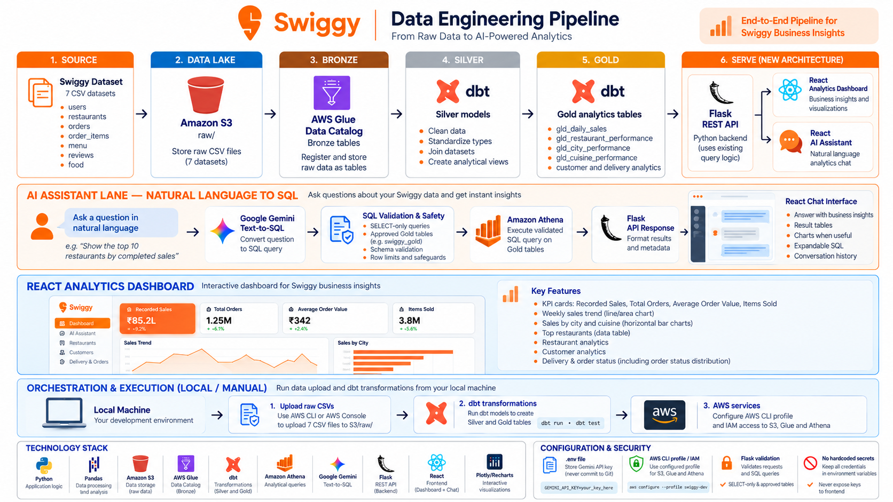

# Swiggy Data Engineering Pipeline

An AWS and dbt analytics pipeline with a Streamlit interface for exploring curated Swiggy data. The project uses Amazon S3 for storage, AWS Glue Data Catalog for table metadata, Amazon Athena for SQL execution, and Google Gemini to turn natural-language questions into draft queries.

> **Project status:** The code and local datasets are present in this workspace. AWS resources, data uploads, and live query results are account-specific and must be verified in your environment. The project has no scheduler or production deployment.

## Overview

The pipeline follows a raw, Silver, and Gold flow:

1. CSV files are stored in S3 under `raw/`.
2. Glue Data Catalog tables describe the files for Athena.
3. dbt builds cleaned Silver views and analytics-oriented Gold tables.
4. The Streamlit dashboard queries Silver views for its metrics, while Ask AI queries the approved Gold tables.

The application does not load the large CSV files into memory. It sends SQL to Athena and displays the returned results.



*End-to-end architecture, analytics flow, and local execution steps.*

## What's included

| Area | Implementation |
|---|---|
| Source data | Seven CSV datasets: food, menu, orders, order items, restaurants, reviews, and users |
| Bronze | dbt source definitions for seven Glue Catalog tables in `swiggy_bronze` |
| Silver | Seven dbt views in `swiggy_silver`, including a users model that excludes names, emails, and passwords |
| Gold | `gld_daily_sales`, `gld_restaurant_performance`, and `gld_food_performance` tables in `swiggy_gold` |
| Data quality | dbt schema tests and a custom test for duplicate menu combinations |
| Application | Streamlit dashboard and Gemini-powered question interface |
| Orchestration | Not included; data upload, dbt runs, and refreshes are manual |

SQL is parsed with SQLGlot and constrained to read-only queries over approved Gold tables and columns. AWS IAM remains the access-control boundary; review this learning project before production use. Sales fields describe recorded order amounts and should not be treated as settled payments without a separate business definition.

## Repository layout

```text
.
├── app/                         # Streamlit, controlled analytics agent, Gemini/Athena
│   └── assets/                  # Swiggy wordmark and app icon (SVG)
├── data/raw/                    # Local CSV inputs; excluded from Git
├── docs/                        # Architecture diagram
├── glue/                        # Glue crawler setup guide
├── swiggy_analytics/            # dbt project, models, and tests
├── tests/                       # Local analytics-agent and SQL-validation tests
├── .env.example                 # Local configuration template
├── .gitignore
└── requirements.txt
```

## Requirements

- Windows with PowerShell
- Python 3.12
- AWS CLI v2 and an AWS identity authorized for the required resources
- Google AI Studio API key for the Gemini interface
- An S3 bucket, Glue Data Catalog tables, and Athena workgroup configured for your AWS account

The checked-in defaults use AWS Region `ap-southeast-2`, bucket `swiggy-pipeline-mrinal`, Athena workgroup `primary`, and query/staging prefix `s3://swiggy-pipeline-mrinal/athena-results/`. Verify these values and your access before running queries. Athena and S3 usage can incur charges.

## Local setup

From the project root in PowerShell:

```powershell
py -3.12 -m venv .venv
.\.venv\Scripts\Activate.ps1
python -m pip install --upgrade pip
python -m pip install -r .\requirements.txt
if (-not (Test-Path .env)) { Copy-Item .env.example .env }
```

Add your Gemini key to the local `.env` file:

```dotenv
GEMINI_API_KEY=your_api_key
```

Do not commit `.env`, AWS credentials, or the local dbt profile. Configure AWS access using your organization's approved method. For an AWS CLI profile named `swiggy-dev`:

```powershell
aws sso login --profile swiggy-dev
$env:AWS_PROFILE = "swiggy-dev"
$env:AWS_DEFAULT_REGION = "ap-southeast-2"
aws sts get-caller-identity --profile $env:AWS_PROFILE --region ap-southeast-2
```

## AWS and dbt configuration

The dbt project is in `swiggy_analytics/`. Its profile is named `swiggy_analytics` and is expected at `%USERPROFILE%\.dbt\profiles.yml`. Keep the profile outside the repository. The local profile should specify the Athena adapter, catalog `awsdatacatalog`, default schema `swiggy_analytics`, workgroup `primary`, and an approved S3 staging location.

dbt source definitions expect these tables in the Glue database `swiggy_bronze`: `food`, `menu`, `orders`, `order_items`, `restaurants`, `reviews`, and `users`. The guide at [glue/crawler_setup.md](glue/crawler_setup.md) describes a crawler targeting `swiggy_raw`, so reconcile the actual Glue database and table names with dbt before running models. In particular, confirm how the S3 folder `restaurant/` maps to the catalog table `restaurants`.

The project macro directs Silver and Gold models to `swiggy_silver` and `swiggy_gold`. The `swiggy_analytics` profile schema is the default and does not mean a Glue database with that name must exist.

Before running dbt, verify the catalog tables, Athena workgroup, S3 results location, and AWS identity. Then run from PowerShell:

```powershell
$ProjectDir = Join-Path (Get-Location) "swiggy_analytics"
$ProfileDir = Join-Path $env:USERPROFILE ".dbt"

dbt debug --project-dir $ProjectDir --profiles-dir $ProfileDir
dbt compile --project-dir $ProjectDir --profiles-dir $ProfileDir
dbt run --project-dir $ProjectDir --profiles-dir $ProfileDir
dbt test --project-dir $ProjectDir --profiles-dir $ProfileDir
```

`dbt run` builds views and tables in Athena; `dbt test` executes queries as well. Both can incur costs. Start only after confirming the source tables and target schemas.

## Run the application

With `.env` and AWS access configured:

```powershell
python -m streamlit run .\app\streamlit_app.py
```

The app provides an **Ask AI** view and an **Analytics** dashboard, with a Swiggy-branded interface. Ask AI uses a bounded workflow: Gemini drafts one SQL query, SQLGlot parses and checks its tables and columns, Athena executes it, and the app summarizes only returned data. It can prepare a bounded Plotly chart for compatible results; it never executes generated Python. The interface reports Gemini, Athena, and result-retrieval timings when available. Chat history supports creating, renaming, and deleting conversations, and editing a question reruns analysis from that turn. History is held in Streamlit session state and is cleared when the session ends. Analytics queries Athena directly and does not require a Gemini API key; AWS access and the Silver views are required. Chat responses are cached for 60 seconds and dashboard queries for 5 minutes; refreshing clears the caches and may run new Athena queries.

The Analytics dashboard reads `swiggy_silver.slv_orders` and `swiggy_silver.slv_restaurants` directly. It filters orders by an applied date range and INR currency, and shows recorded sales, distinct order counts, weekly trends, and city/cuisine breakdowns. The restaurant leaderboard aggregates order metrics from Silver orders and joins them to Silver restaurant details. Recorded sales include all order statuses; completed restaurant sales include orders whose status is completed. Ask AI remains restricted to `swiggy_gold.gld_daily_sales`, `swiggy_gold.gld_restaurant_performance`, and `swiggy_gold.gld_food_performance`; “most selling dish” ranks units across all statuses unless you specify completed orders. Run dbt to build the Silver views and Gold food performance model before using the application.

An optional Gemini connectivity check is available at `app/test_openai.py` (the filename is retained for historical reasons). Running it makes an external API request and may use quota:

```powershell
python .\app\test_openai.py
```

## Validation

Run the local mocked agent and SQL-safety checks with:

```powershell
python -m unittest discover -s tests -v
python -m compileall -q .\app .\tests
```

Other useful local checks include:

```powershell
python -m pip check
dbt ls --project-dir .\swiggy_analytics --profiles-dir "$env:USERPROFILE\.dbt"
```

These checks do not prove that your AWS resources or live data are correct. Verify the Glue schemas, S3 locations, Athena workgroup, model results, and test output in your own account. Avoid scanning the full `orders` and `order_items` CSVs for exploratory work; they are large files.

## Security and cost

- Raw datasets are excluded from Git. The users dataset contains sensitive information; do not publish it or expose unnecessary personal data in models, logs, screenshots, or reports.
- Never commit `.env`, API keys, AWS credentials, or `%USERPROFILE%\.dbt\profiles.yml`.
- Use short-lived credentials and least-privilege IAM permissions where available.
- SQLGlot parsing, table and column allowlists, a 5,000-row SQL limit, and a 180-second Athena timeout constrain application queries. These controls do not replace AWS IAM or a production security review.
- Athena charges are based on data scanned. Select only needed columns, apply useful filters, and check scanned data before repeating queries.
- Keep Athena result objects private and apply suitable retention and encryption settings.

## Limitations

- AWS resource setup, source uploads, dbt execution, and app refreshes are manual.
- Glue table naming and the `swiggy_raw` versus `swiggy_bronze` database configuration must be reconciled for the target account.
- The Gemini model ID (`gemini-3.8-flash`) and AWS defaults may need updating for your account.
- The project is a learning and development implementation; it has not been security-reviewed or deployed for production.

## Cleanup

Stop Streamlit with **Ctrl+C**. To remove only the local virtual environment later, deactivate it and run:

```powershell
deactivate
Remove-Item -Recurse -Force .\.venv
```

AWS cleanup is separate. Inspect ownership, dependencies, and stored data before changing or deleting any AWS resource. Do not empty or remove buckets, databases, or tables as a routine local cleanup step.
