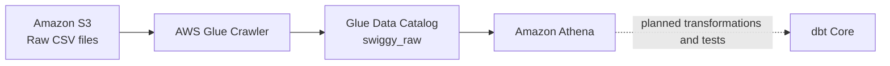

# AWS Glue Crawler Setup

This guide describes how to catalog the Swiggy project's raw CSV files with AWS Glue and query them with Amazon Athena. It is a setup guide, not a report of an already-created or successfully run crawler. Confirm environment-specific settings in the AWS Management Console before running anything.

## 1. Purpose

An AWS Glue crawler examines data in a supported source, infers its structure and format, and creates or updates metadata in the AWS Glue Data Catalog. For this project, the crawler will inspect CSV files in Amazon S3 and register tables in the `swiggy_raw` database.

The crawler does not move or transform the CSV files. The Glue Data Catalog stores metadata such as table names, columns, and S3 locations. Athena reads that metadata to interpret the S3 files when you run SQL queries. This gives the project a path from raw files to queryable data without first loading those files into a database.

## 2. Architecture

The intended flow is:

```text
S3 Raw CSV Files → AWS Glue Crawler → Glue Data Catalog (swiggy_raw) → Amazon Athena → dbt Core (planned)
```



dbt Core is a planned later stage. The crawler and catalog provide metadata; Athena runs queries; dbt will manage transformation SQL and data-quality tests on top of the query engine.

## 3. Prerequisites

Before creating the crawler, confirm that you have:

- Access to an AWS account and the AWS Management Console.
- The correct AWS Region for this project and permission to use AWS Glue, Amazon S3, and Athena there.
- The S3 bucket `swiggy-pipeline-mrinal` and the seven raw CSV files at the paths listed below.
- An IAM role that AWS Glue can assume, with appropriate Glue, S3, and Data Catalog permissions (see [Glue IAM Role and Security](#5-glue-iam-role-and-security)).
- An Athena workgroup, or permission to use the intended workgroup.
- A configured S3 location for Athena query results. Athena needs an output location before it can save query results.

The S3 bucket, Glue resources, and Athena workgroup should be in the intended Region. Check the Region selector in the AWS Console rather than assuming that a resource exists in the currently selected Region. Athena query results are also written to S3; use a deliberate output prefix and ensure your identity can write to it.

## 4. S3 Source Configuration

Use the dataset prefixes as crawler targets where possible. A prefix is the folder-like S3 path ending in `/`; the expected CSV file is listed separately.

| Dataset | S3 prefix | Expected CSV file |
|---|---|---|
| `food` | `s3://swiggy-pipeline-mrinal/raw/food/` | `food.csv` |
| `menu` | `s3://swiggy-pipeline-mrinal/raw/menu/` | `menu.csv` |
| `orders` | `s3://swiggy-pipeline-mrinal/raw/orders/` | `orders.csv` |
| `order_items` | `s3://swiggy-pipeline-mrinal/raw/order_items/` | `order_items.csv` |
| `restaurant` | `s3://swiggy-pipeline-mrinal/raw/restaurant/` | `restaurant.csv` |
| `reviews` | `s3://swiggy-pipeline-mrinal/raw/reviews/` | `reviews.csv` |
| `users` | `s3://swiggy-pipeline-mrinal/raw/users/` | `users.csv` |

The expected logical table names are `food`, `menu`, `orders`, `order_items`, `restaurants`, `reviews`, and `users`. Note that the S3 folder is named `restaurant` (singular), while the expected logical/catalog table is `restaurants` (plural). A crawler may derive a different table name from the S3 path or its configuration. Verify the actual names in the Glue Data Catalog and use those exact names in Athena.

## 5. Glue IAM Role and Security

An AWS Glue crawler needs an IAM role because it runs as an AWS service and must be authorized to inspect the source data and write metadata. Select or create a role that:

- Has a trust relationship allowing the AWS Glue service principal `glue.amazonaws.com` to assume the role.
- Has appropriate Glue service permissions for the crawler to run and log its activity.
- Can list the relevant S3 bucket/prefixes and read the source objects under the seven raw dataset paths.
- Can create or update the required Glue Data Catalog database and table objects in the intended Region.

Grant only the permissions and resource access needed for this crawler. Avoid unrestricted administrator permissions as a convenience. The exact policy should be reviewed against your account's resource names, Region, and organizational controls; do not assume those values or copy an unverified policy into production.

An AWS-managed Glue service-role policy may provide Glue-related permissions, but it does **not** automatically grant access to this custom bucket, `swiggy-pipeline-mrinal`. S3 bucket policies, IAM identity policies, encryption settings, or organization controls may need separate configuration. Check both the role's permissions and any bucket-level restrictions. Never put AWS access keys, secret keys, passwords, or other credentials in this repository or GitHub.

## 6. Creating the Glue Crawler

The console labels can change over time, but the setup is generally as follows:

1. Sign in to the AWS Management Console and open **AWS Glue** in the intended Region.
2. In the navigation pane, open **Crawlers** and choose **Create crawler**.
3. Enter a descriptive name, for example `swiggy-raw-crawler`.
4. Add a data source and choose **S3**.
5. Configure the S3 source paths. Prefer the seven dataset-specific prefixes in [S3 Source Configuration](#4-s3-source-configuration), rather than an unnecessarily broad path.

   Two reasonable designs are:

   - **One crawler with separate targets** for the seven dataset prefixes, if the current wizard supports adding all targets in the desired way. This centralizes setup and operation.
   - **Separate crawlers per dataset** when schema isolation, independent schedules, or simpler troubleshooting are more important.

   Avoid unintentionally grouping unrelated CSV datasets into one table. A single broad parent prefix such as `s3://swiggy-pipeline-mrinal/raw/` can lead to unexpected grouping, depending on schemas and crawler configuration. Review the crawler's grouping behavior and the resulting table locations before relying on the output.

6. Select an existing IAM role that meets the requirements above, or create an appropriate role through the console workflow. Confirm that the trust relationship and S3 access cover these sources.
7. Configure the target database as `swiggy_raw`. Create the database if it does not already exist.
8. Choose an **on-demand** schedule for initial setup so that you control when the first crawl runs.
9. Review the data sources, IAM role, target database, and any crawler options, then create the crawler.
10. Select the crawler and choose **Run**. Inspect its run status and logs in the Glue Console. Resolve any reported errors before relying on the catalog output.

These steps describe the intended configuration. They do not indicate that a crawler has already been created or has run successfully.

## 7. Verifying the Catalog

After a crawler run has completed, inspect the database and tables in the Glue Console. Table names can differ from the expected logical names, so verify the actual catalog objects before querying.

In Athena, select the intended workgroup and run:

```sql
SHOW TABLES IN swiggy_raw;
```

Use an exact table name from the output to preview rows. For example, if the catalog table is actually named `orders`:

```sql
SELECT *
FROM swiggy_raw.orders
LIMIT 10;
```

The database and table names in a query must match the actual Glue Data Catalog objects. If the crawler created a different name, substitute that name rather than assuming the expected name.

Where supported by the configured Athena catalog, inspect column metadata with:

```sql
SELECT table_name, column_name, ordinal_position, data_type
FROM information_schema.columns
WHERE table_schema = 'swiggy_raw'
ORDER BY table_name, ordinal_position;
```

You can also open the database and individual tables in the Glue Console to inspect their schema, S3 location, and table properties. Check that inferred column names and types make sense for each CSV file.

## 8. Common Errors and Troubleshooting

| Symptom | Likely causes | Practical checks |
|---|---|---|
| Access denied while reading S3 | The crawler role cannot list the bucket or read the object; a bucket policy, encryption key policy, or organization control blocks access. | Confirm the role used by the crawler; verify list/read access for the specific source prefixes and any encryption permissions required; inspect bucket and key policies. Do not default to granting broad access. |
| Missing or incorrect IAM role trust relationship | The role does not trust AWS Glue, or the crawler is configured to use another role. | In IAM, inspect the role's trust relationship for the Glue service principal `glue.amazonaws.com`; confirm the crawler's selected role. |
| Crawler succeeds but expected tables are missing | A source prefix was omitted or mistyped; files are absent or unreadable; grouping or crawler configuration combined data unexpectedly. | Compare each configured target with the seven paths in this guide; confirm objects exist; review crawler logs, table locations, and grouping settings. |
| Unexpected table names or grouping | Names are derived from S3 paths or crawler settings; broad targets or compatible schemas may affect grouping. | Inspect each table's S3 location and schema in Glue. Prefer dataset-specific prefixes or separate crawlers where isolation is needed; use actual catalog names in queries. |
| CSV headers interpreted incorrectly | Header handling or CSV format inference did not match the file; the file may lack a header or use unusual delimiters/quoting. | Inspect the first lines of the source CSV and the inferred schema/table properties. Review the crawler's CSV/classifier settings and any available header options, then recrawl and verify. |
| Incorrect Region or resources appear missing | The console, bucket, crawler, catalog, or Athena workgroup is being viewed in a different Region. | Check the Region selector and confirm the intended Region for each resource. |
| Athena says query result location is not configured | The selected workgroup has no S3 query-result output location, or its settings require one. | Configure or select an Athena workgroup with an approved S3 results location. Confirm write access for the identity running the query. |
| Athena cannot find a table | Wrong Region, database, catalog, workgroup, or table name; crawler has not populated the expected object. | Run `SHOW TABLES IN swiggy_raw`; verify the active Athena catalog and Region and compare against Glue Console. Use the exact database and table names that exist. |
| Query returns no rows or CSV data looks malformed | The table points to the wrong S3 location; files are empty; delimiter, quoting, encoding, or row structure differs from what was inferred. | Check the table's S3 location and the source objects; inspect a small sample of the CSV and the catalog's format/serde properties; compare column values using a limited query. |

When troubleshooting, check the crawler run details and logs first, then verify the source locations, role, and resulting Catalog metadata. Avoid treating a successful crawler status alone as proof that table names, schemas, or Athena results are correct.

## 9. Cost and Operational Best Practices

AWS Glue crawlers, S3 storage and requests, and Athena queries can incur charges. Check current AWS pricing and your account's cost controls before using these services.

- Use on-demand crawler runs during development; avoid frequent schedules until there is a demonstrated need.
- Keep crawler targets focused on the intended dataset prefixes.
- Limit Athena scans while exploring. Use `LIMIT` to restrict returned rows, but remember that it does not necessarily reduce the amount of data scanned. Select only needed columns and consider partitioning or columnar formats as the pipeline evolves.
- Use a dedicated Athena query-results S3 prefix, separate from the raw source prefixes, and apply appropriate access and lifecycle policies.
- Review crawler logs, table locations, and schemas after changes to source files or crawler settings.
- Introduce a crawler schedule later if source schemas change regularly and automatic catalog updates are useful.

## 10. Integration with dbt Core

dbt Core is a later transformation layer; it does not replace the Glue crawler. The crawler discovers source structure and registers metadata in the Glue Data Catalog. Athena uses that catalog to query the source data. A dbt project configured with a compatible Athena adapter can then run transformation SQL through Athena, using catalog databases and tables as its sources and models.

The identity used by dbt must have suitable permissions for the actions it performs. Depending on the adapter and project configuration, that may include running Athena queries, reading and writing Athena query results in S3, reading source data from S3, and creating or updating target metadata or objects in Glue. Scope permissions to the actual workflows and resources. Configure identity and connection details through an approved local or deployment mechanism; do not commit credentials or invent account-specific settings in project documentation.

## 11. Maintenance Checklist

- [ ] Confirm the intended AWS Region in the console.
- [ ] Confirm the bucket and all seven S3 prefixes and CSV objects exist.
- [ ] Confirm the crawler uses the intended IAM role and that its trust relationship allows AWS Glue.
- [ ] Confirm the role and applicable bucket policies allow the required source reads and Catalog updates.
- [ ] Check the latest crawler run status and review its logs.
- [ ] Confirm the target database is `swiggy_raw`.
- [ ] Verify actual table names and S3 locations; account for `restaurant` versus expected `restaurants`.
- [ ] Review inferred columns, data types, and CSV format settings for every table.
- [ ] Run `SHOW TABLES IN swiggy_raw;` and a limited Athena preview using actual table names.
- [ ] Confirm the selected Athena workgroup has a configured query-result S3 location and the query identity can write there.
- [ ] Review crawler frequency, query scan sizes, S3 usage, and service costs as the project grows.

## 12. References

- [AWS Glue crawlers](https://docs.aws.amazon.com/glue/latest/dg/add-crawler.html)
- [AWS Glue identity-based IAM policies and permissions](https://docs.aws.amazon.com/glue/latest/dg/security_iam_id-based-policy-examples.html)
- [AWS Glue Data Catalog](https://docs.aws.amazon.com/glue/latest/dg/catalog-and-crawler.html)
- [Amazon Athena user guide](https://docs.aws.amazon.com/athena/latest/ug/what-is.html)
- [Athena query results location](https://docs.aws.amazon.com/athena/latest/ug/querying.html)